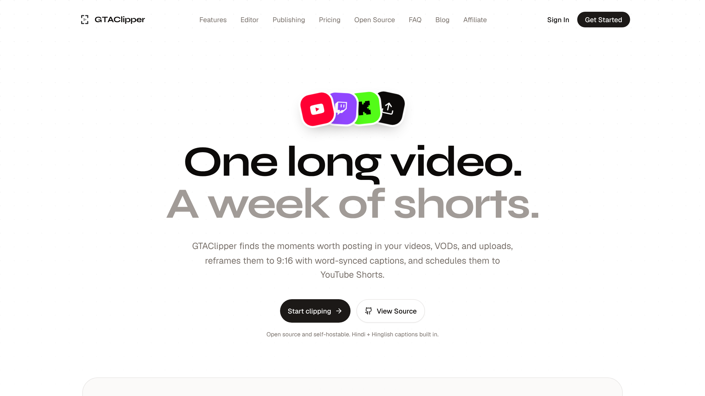

<p align="center">
  
</p>

<h1 align="center">Clippers — AI Video Clipper & Shorts Generator</h1>

<p align="center">
  <b>Turn long videos into viral Shorts, Reels, and TikToks with AI.</b><br/>
  Auto-transcription, face tracking, 9:16 reframing, word-by-word captions, and viral hook detection.
</p>

<p align="center">
  <a href="https://clippers.narang.store"><b>🌐 Live Website: clippers.narang.store</b></a> ·
  <a href="#whats-inside">Features</a> ·
  <a href="#quick-start">Quick Start</a> ·
  <a href="#creator">Creator</a>
</p>

<p align="center">
  <a href="https://clippers.narang.store"></a>
  <a href="https://github.com/Object2005/clippers.narang.store"></a>
  
</p>

---

## 🌐 Live Platform

Access the live production platform directly at:
👉 **[https://clippers.narang.store](https://clippers.narang.store)**

---

## ✨ What it does

Paste a **YouTube, Twitch or Kick** link (or upload an MP4/MOV video). Clippers will:

1. 🎙️ **Transcribe** the audio with word-level precision and animated timing.
2. 🧠 **Find the most viral moments** with advanced AI scoring.
3. 🎯 **Crop to vertical 9:16**, actively keeping the speaker centered with face tracking.
4. ✍️ **Add animated captions** in bold viral styles (yellow highlights, custom fonts, emojis).
5. 🚀 Give you **ready-to-post vertical clips** for Instagram Reels, YouTube Shorts, and TikTok.

---

## 🔥 Features & Capabilities

- 🎬 **AI Moment Selection:** Gemini, Claude, GPT, or local Ollama models identify viral hooks.
- 🗣️ **Animated Captions:** Word-by-word highlight animations with 99+ languages, including Hindi and Hinglish.
- 🙂 **Smart Face Reframing:** Automatically tracks speaker faces and switches camera views during podcasts.
- ✂️ **In-Browser Video Editor:** Fine-tune timestamps, edit caption text, customize fonts, colors, and layout.
- 💳 **Billing & Monetization:** Integrated Razorpay checkout (UPI, Cards, Netbanking) with coupon discounts.
- 📧 **Automated Notifications:** SMTP confirmation emails on membership activation and updates.

---

## 🚀 Quick Start (Self-Hosting with Docker)

```bash
# Clone the repository
git clone https://github.com/Object2005/clippers.narang.store.git
cd clippers.narang.store

# Configure environment variables
cp .env.example .env

# Run services
./run_live.sh
# or: docker compose up -d
```

Open **http://localhost:3107** or your public Cloudflare domain.

---

## 👨‍💻 Creator & Maintainer

Created and maintained by **Aashray Narang**:
* 🌐 **Website:** [https://clippers.narang.store](https://clippers.narang.store)
* 🐙 **GitHub:** [@Object2005](https://github.com/Object2005)
* 📧 **Contact & Support:** [narangaashray98@gmail.com](mailto:narangaashray98@gmail.com)

---

## 📄 License

This project is licensed under the **GNU AGPL-3.0 License**. See [LICENSE](LICENSE) and [NOTICE](NOTICE) for details.
